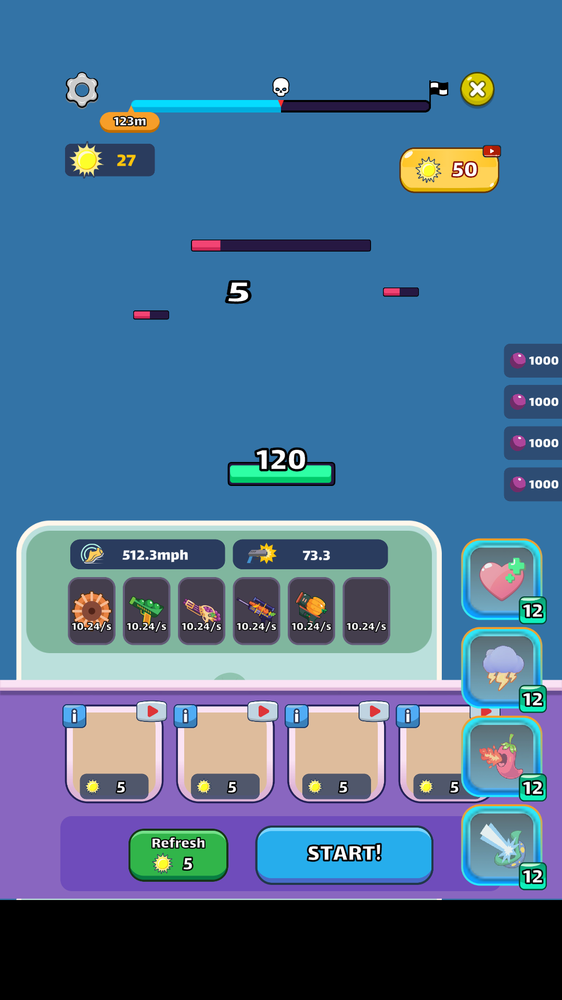
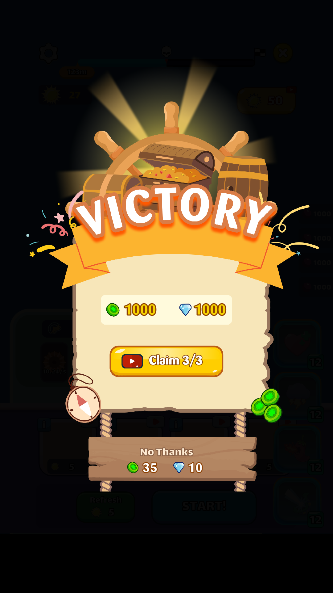
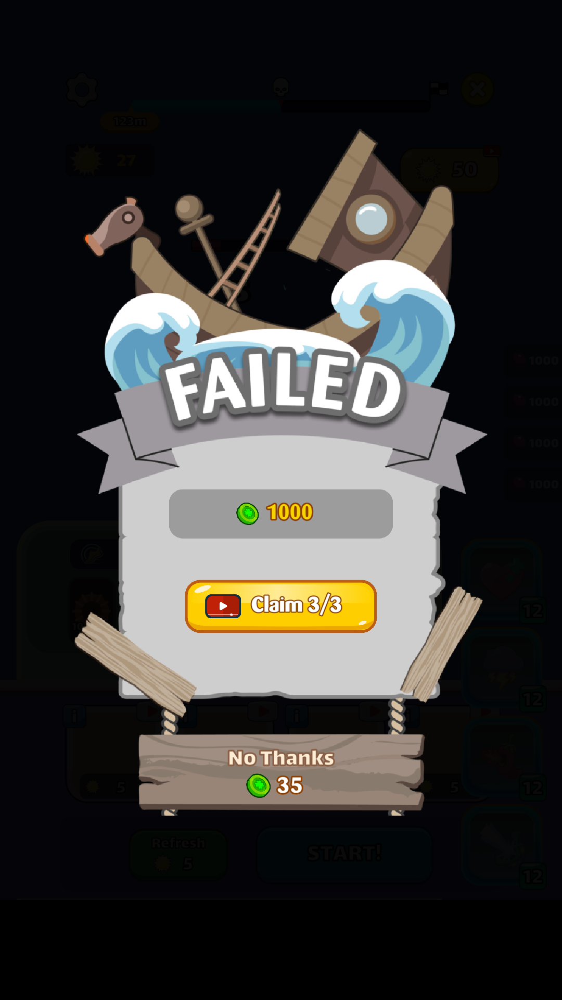
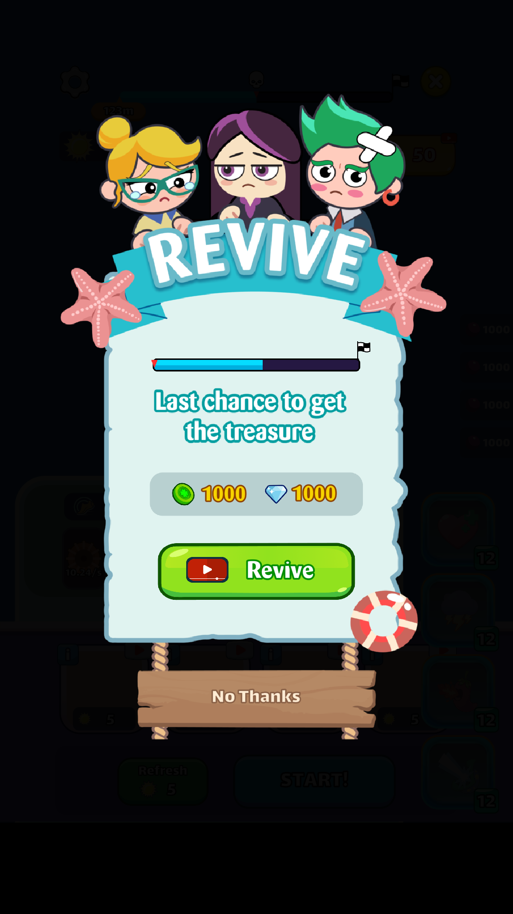
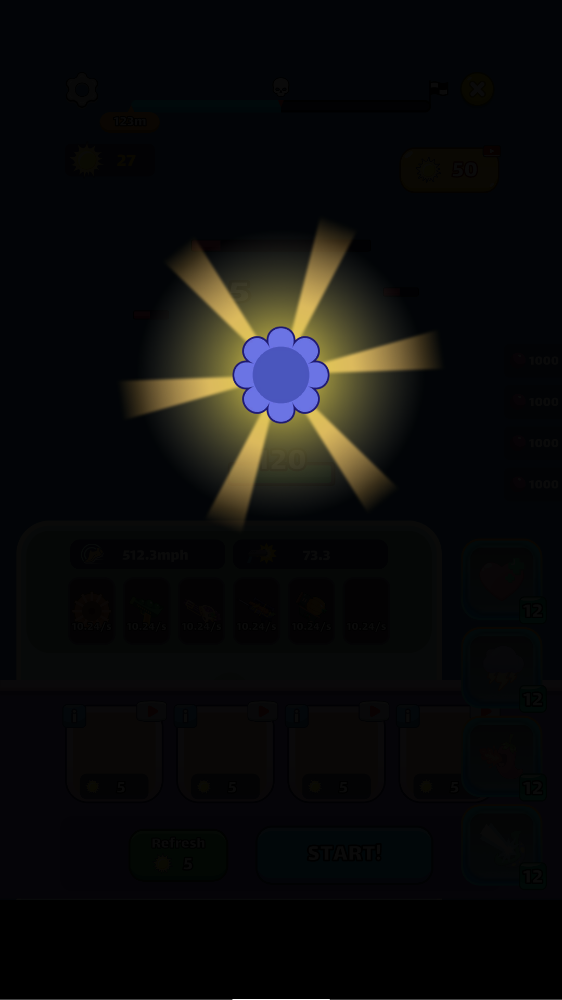
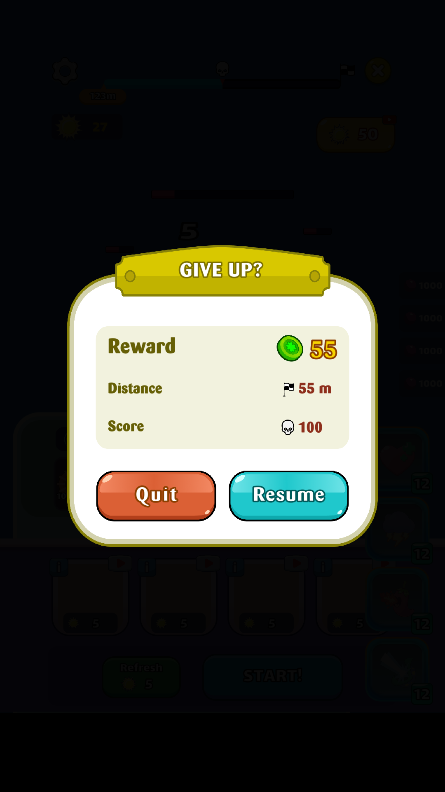
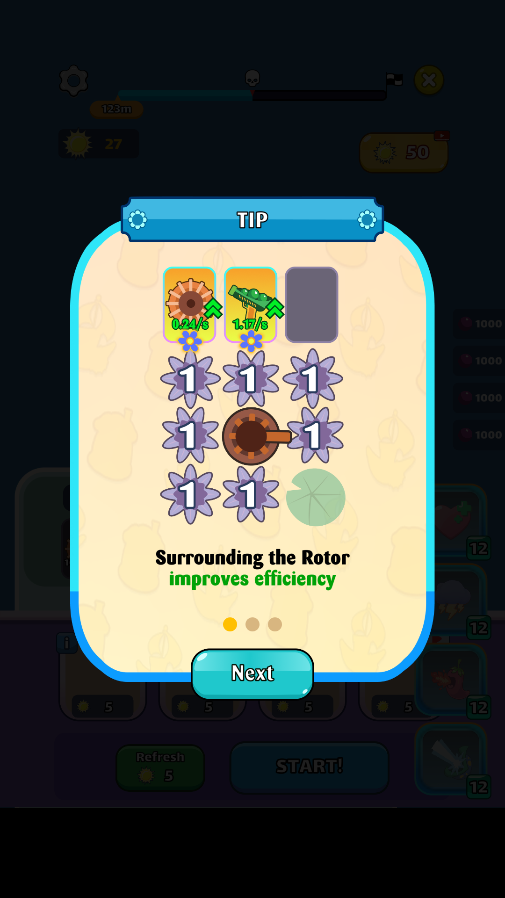
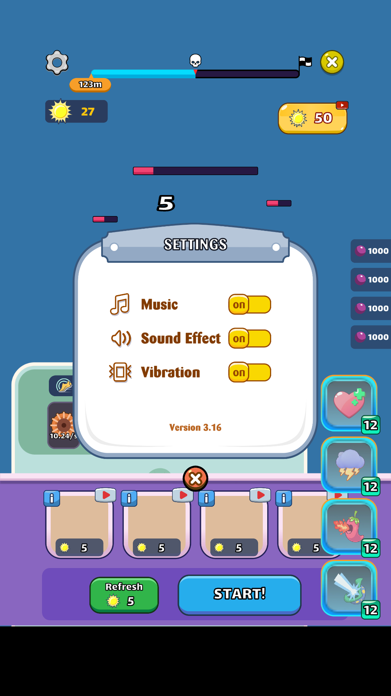

# Gear – Combat UI

Bộ UI màn chiến đấu chính của game **Gear**, tách riêng từ project gốc để dùng cho bài tập thiết kế UI trong game.
Project chỉ chứa **UI** (sprite, font, prefab, animation). Toàn bộ logic gameplay đã được gỡ bỏ.

- Unity **2022.3.62f2** (Built-in Render Pipeline)
- Mở scene: `Assets/CombatUI/CombatUI_Demo.unity`
- Game view: chọn độ phân giải dọc **1080×1920**

## Màn hình

| HUD chiến đấu | Victory | Failed | Revive |
|---|---|---|---|
|  |  |  |  |

| Unlock | Give up | Tutorial | Settings |
|---|---|---|---|
|  |  |  |  |

## Thành phần

**HUD màn hình** (`Prefabs/UI Canvas.prefab`)
- Thanh tiến trình level: quãng đường, mốc boss 💀, đích 🏁, nút Settings / Thoát
- Tiền trong trận, nút nhận thưởng xem quảng cáo
- Khay Gear: tốc độ thuyền, sát thương, 6 ô vũ khí
- Shop Gear: 4 ô mua, nút Refresh và START!
- Booster: Hồi máu, Sét (choáng), Lửa (đốt), Beam
- Bộ đếm đạn, vùng banner quảng cáo
- Popups: Win, Unlock Feature, Lose, Revive, Give Up, Tutorial, Warning, Settings

**UI world-space** (gắn trên thuyền/quái)
- `BoatContainer_HealthBar`: máu thuyền + số HP
- `BoatContainer_ShieldController`: khiên
- `Enemy_HealthBar`, `Boss_HealthBar`: thanh máu quái / boss
- `*_Status_Canvas`: icon trạng thái Độc / Choáng / Cháy
- `PoolObject_DamageNumberFX_DamageText`: số damage bay lên

## Xem thử

Bấm Play rồi dùng phím số để bật popup (script `UIPreviewSwitcher`, chỉ phục vụ việc xem):

| Phím | Popup |
|---|---|
| 0 | Ẩn hết |
| 1 | Victory |
| 2 | Unlock Feature |
| 3 | Failed |
| 4 | Revive |
| 5 | Give Up |
| 6 | Tutorial |
| 7 | Warning |
| 8 | Settings |

Menu **Combat UI → Rebuild Demo Scene** dựng lại scene demo từ các prefab.

## Ghi chú

- Các script gameplay (GearManager, UIManager, Popup controllers, UIAutoAnimation…) đã được gỡ. Vì vậy nút bấm không chạy logic, và các hiệu ứng tween/animation do code điều khiển sẽ không chạy.
- Các component hiển thị vẫn được giữ: Image, TextMeshPro, Button, Layout, Animator, `SlicedFilledImage`, `ImageWithRoundedCorners`.
