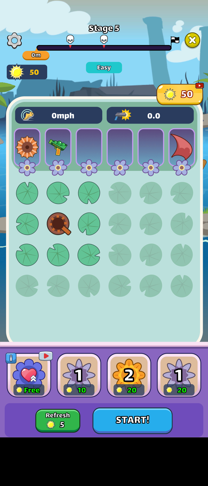
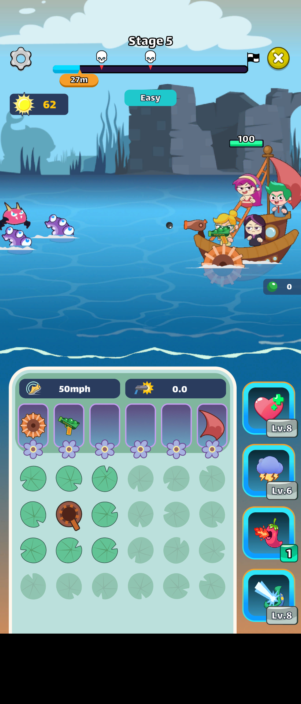
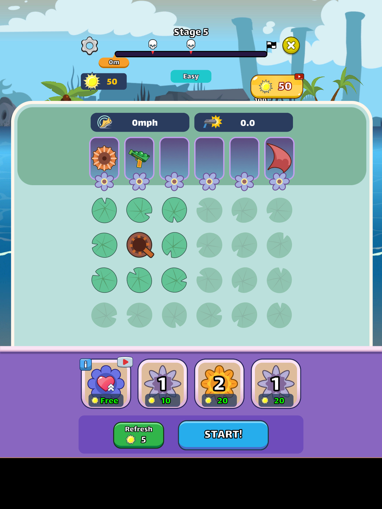
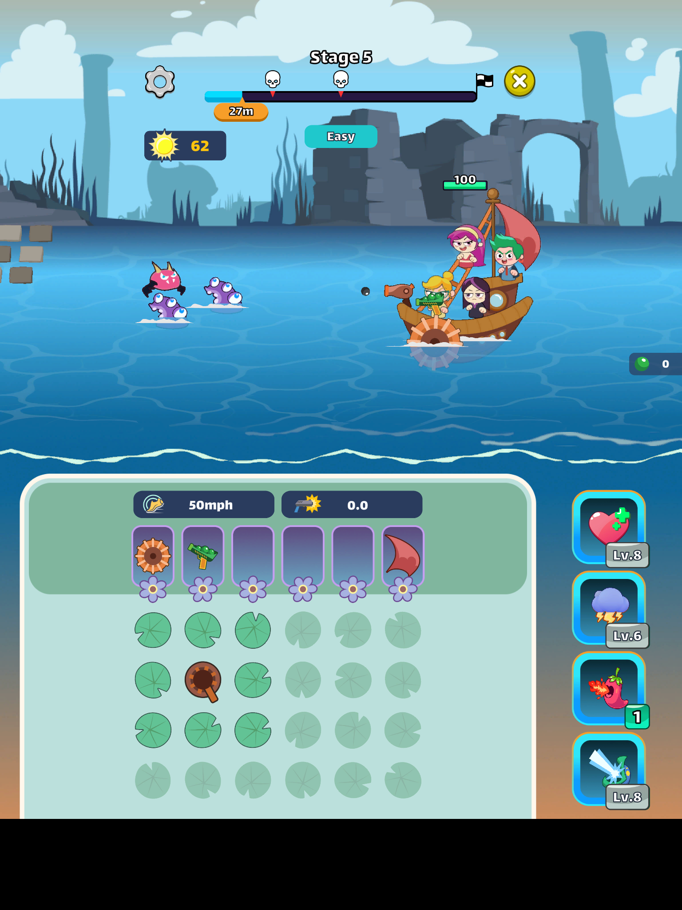

# Gear (Flower Escape) – Combat UI

Bài thực hành 4 – Tích hợp giao diện vào game engine.

Tích hợp UI màn gameplay chính của game mobile xếp gear **Flower Escape** vào Unity, gồm 2 trạng thái **combat** và **xếp gear**, responsive với màn **9:21** và **3:4**.

- Unity **2022.3.62f2**
- Scene: `Assets/CombatUI/CombatUI_Demo.unity`
- Xem bằng **Device Simulator** (Window → General → Device Simulator):
  - 9:21: thiết bị `Phone 9x21 (1080x2520)` (file `Assets/CombatUI/Devices/Phone 9x21.device`)
  - 3:4: `Apple iPad (5th generation)`

## Kết quả

| | Xếp gear | Combat |
|---|---|---|
| **9:21** (1080×2520) |  |  |
| **3:4** (1536×2048) |  |  |

## Cách làm

- UI được lấy trực tiếp từ game lúc đang chạy (Stage 5), ở đúng 2 trạng thái: xếp gear và combat. Mọi thứ do code sinh ra lúc chạy, như lưới lá sen, gear, shop, booster, tiến trình level và popup, đều được giữ đúng vị trí.
- Toàn bộ script gameplay đã được gỡ. Chỉ giữ component hiển thị: Image, TextMeshPro, Button, Layout, Canvas, `SlicedFilledImage`, `ImageWithRoundedCorners`.
- UI world-space (thanh máu thuyền và quái, số damage) giữ nguyên tọa độ thế giới. Camera giống hệt game: ortho size 11, vị trí (0, 7.95, −9), góc 45°.
- Nền cảnh biển là ảnh render thế giới game, không phải UI. Ảnh được đặt trong không gian thế giới, cao đúng khung camera và rộng đủ cho 3:4. Vì vậy màn hẹp chỉ bị cắt hai bên giống game thật, còn UI world-space luôn khớp vị trí.

## Responsive

- HUD dùng CanvasScaler tham chiếu **900×1600**.
- `ResponsiveCanvasScaler` (`Assets/CombatUI/Scripts`) chọn cách scale theo tỉ lệ màn:
  - Màn rộng như **3:4**: khớp theo chiều cao giống game gốc. Phần dư chiều ngang thành khoảng trống hai bên.
  - Màn rất dài như **9:21**: nếu khớp theo chiều cao, bề ngang còn dưới 740 đơn vị và UI sẽ bị cắt hai bên. Script chỉ chuyển sang khớp chiều rộng vừa đủ để luôn giữ được 740 đơn vị bề ngang. Phần dư chiều cao nằm giữa thanh trên cùng và khay gear.
- Các thành phần neo theo cạnh: thanh trên cùng neo trên, khay gear và shop neo dưới, cột booster neo phải.

## Xem thử khi Play

| Phím | Chức năng |
|---|---|
| Tab | Đổi trạng thái xếp gear ↔ combat |
| 1–8 | Bật popup: Victory, Unlock, Failed, Revive, Give Up, Tutorial, Warning, Settings |
| 0 | Ẩn popup |

Menu **Combat UI → Rebuild Demo Scene** dựng lại scene từ các prefab.
